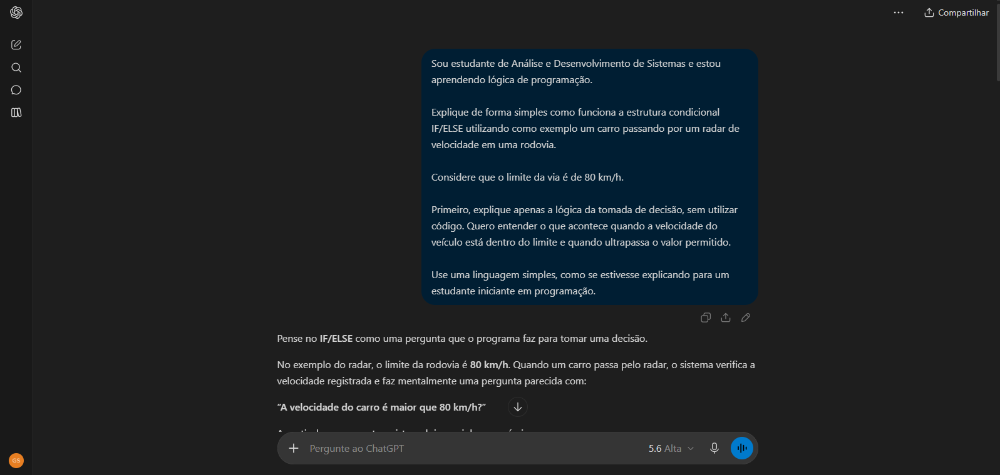
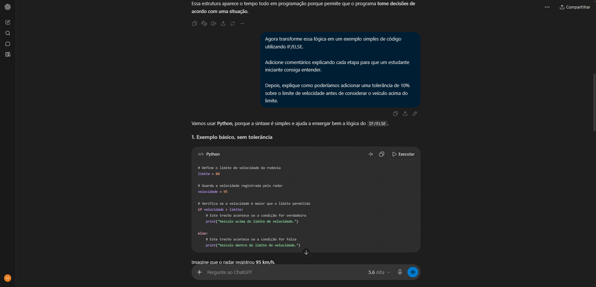

# ⎙ Engenharia de Prompt Aplicada

<p>
  
  
  
</p>

Projeto acadêmico voltado à aplicação prática de **Engenharia de Prompt** em problemas relacionados à lógica de programação.

O objetivo desta atividade foi analisar como diferentes níveis de detalhamento em um prompt podem influenciar a **qualidade, clareza e utilidade das respostas produzidas por uma Inteligência Artificial Generativa**.

Neste estudo, foi utilizado como exemplo um sistema simples de **radar de velocidade**, aplicando conceitos de estruturas condicionais como `IF/ELSE` e demonstrando como o refinamento progressivo das instruções pode auxiliar na compreensão de um problema.

---

## ⎘ Objetivo do projeto

O principal objetivo deste projeto foi compreender como a construção e o refinamento de prompts podem melhorar a interação entre o usuário e uma Inteligência Artificial.

Ao invés de solicitar diretamente a geração de uma solução, foram utilizadas diferentes versões de um mesmo prompt para:

- ☉ compreender primeiro a lógica do problema;
- ☉ adaptar a explicação para um estudante iniciante;
- ☉ transformar a lógica em um exemplo prático;
- ☉ adicionar novas regras ao problema;
- ☉ observar como o contexto fornecido influencia a resposta da IA;
- ☉ utilizar a Inteligência Artificial como ferramenta de apoio ao aprendizado.

---

## ✎ Conceitos trabalhados

Durante a atividade foram explorados conceitos relacionados a:

- ⊹ Inteligência Artificial Generativa;
- ⊹ Engenharia de Prompt;
- ⊹ LLMs;
- ⊹ Refinamento de instruções;
- ⊹ Lógica de Programação;
- ⊹ Estruturas condicionais `IF/ELSE`;
- ⊹ IA como ferramenta de apoio ao aprendizado;
- ⊹ Uso crítico e responsável da Inteligência Artificial.

---

## ⌨ Prompt inicial

O primeiro comando utilizado foi bastante simples:

> **"Escreva um código para um radar de trânsito."**

Esse tipo de solicitação possui pouco contexto e não informa para a Inteligência Artificial pontos importantes como:

- ⊹ o nível de conhecimento do usuário;
- ⊹ o objetivo educacional da atividade;
- ⊹ o nível de detalhamento esperado;
- ⊹ o formato desejado para a resposta.

Diante disso, o prompt foi sendo refinado gradualmente.

---

## ♻︎ Refinamento dos prompts

### ① Variação 1 — Compreendendo a lógica

Na primeira etapa do refinamento, o objetivo foi utilizar a IA como uma ferramenta de explicação antes de solicitar a geração de código.

**Prompt utilizado:**

> **"Sou iniciante em programação e estou aprendendo lógica. Explique como funciona a estrutura IF/ELSE usando um exemplo prático de um carro passando por um radar de velocidade em uma rodovia. Considere que o limite da via é de 80 km/h. Não utilize código ainda. Explique apenas a lógica da tomada de decisão de forma simples."**

Ao adicionar informações sobre o nível de conhecimento do usuário, o contexto e o formato esperado, a resposta tornou-se mais direcionada para o aprendizado.

---

### ② Variação 2 — Transformando a lógica em código

Depois de compreender a lógica do problema, o próximo passo foi solicitar uma implementação prática.

**Prompt utilizado:**

> **"Agora transforme essa lógica em um exemplo simples de código utilizando IF/ELSE. Adicione comentários explicando cada etapa para que um estudante iniciante consiga entender."**

Nesta etapa, a Inteligência Artificial passou da explicação conceitual para uma representação prática da lógica estudada.

---

### ③ Variação 3 — Adicionando uma nova regra

Para aumentar a complexidade do problema, foi adicionada uma nova condição relacionada à tolerância utilizada no exemplo acadêmico do radar.

**Prompt utilizado:**

> **"Como poderíamos adicionar uma tolerância de 10% sobre o limite de velocidade antes de considerar o veículo acima do limite? Explique também o cálculo utilizado."**

Neste caso, a IA precisou interpretar uma nova regra, realizar o cálculo necessário e adaptar a estrutura lógica já desenvolvida.

Considerando um limite de **80 km/h**:

```text
80 × 1,10 = 88 km/h
```

Portanto, dentro do exemplo acadêmico utilizado neste projeto, o veículo seria considerado acima do limite com tolerância quando ultrapassasse **88 km/h**.

> ⚠︎ **Observação:** a tolerância de 10% é utilizada apenas como regra didática do exercício e não representa necessariamente as regras reais utilizadas na fiscalização de trânsito.

---

## ⎙ Exemplo prático

A lógica desenvolvida durante a atividade foi transformada em um pequeno programa presente no arquivo:

`radar_velocidade.py`

Uma versão simplificada da lógica é:

```python
limite_velocidade = 80
velocidade_carro = 90

limite_com_tolerancia = limite_velocidade * 1.10

if velocidade_carro > limite_com_tolerancia:
    print("Veículo acima do limite com tolerância.")
else:
    print("Velocidade dentro do limite permitido.")
```

No arquivo `radar_velocidade.py` disponível neste repositório, o usuário também pode informar uma velocidade e testar o funcionamento da estrutura condicional.

O exemplo demonstra como o processo começou com uma explicação conceitual e evoluiu até uma implementação prática através do **refinamento dos prompts**.

---

## 🅾︎ Demonstração da interação com IA

Como a conversa original utilizada durante a realização da atividade não estava mais disponível, foram **recriados exemplos da interação seguindo a mesma proposta e estrutura dos prompts utilizados originalmente**.

As imagens abaixo possuem finalidade demonstrativa e representam o processo de refinamento estudado durante a atividade.

### ☟ Etapa 1 — Explicação da lógica

Nesta primeira interação, foi solicitado que a Inteligência Artificial explicasse a estrutura `IF/ELSE` utilizando como exemplo um radar de velocidade, sem apresentar código inicialmente.

<p align="center">
  
</p>

---

### ☟ Etapa 2 — Refinamento e aplicação prática

Na segunda interação, o prompt foi refinado para transformar a explicação anterior em uma solução prática e posteriormente adicionar uma tolerância de 10% ao exemplo.

<p align="center">
  
</p>

---

## ➡︎⬅︎ Comparação entre os prompts

| Etapa | Característica | Resultado esperado |
| :--- | :--- | :--- |
| **Prompt inicial** | Genérico e sem contexto | Resposta mais direta e pouco personalizada |
| **Variação 1** | Contexto + nível do usuário | Explicação didática da lógica |
| **Variação 2** | Objetivo + formato | Transformação da lógica em solução prática |
| **Variação 3** | Nova regra + explicação | Adaptação da solução e explicação matemática |

A comparação demonstra que aumentar a quantidade de contexto relevante não significa simplesmente criar prompts maiores, mas fornecer **informações que ajudem o modelo a compreender melhor a intenção do usuário**.

---

## ✔︎ O que aprendi

Durante o desenvolvimento desta atividade, percebi que a qualidade das respostas produzidas por uma Inteligência Artificial está bastante relacionada à forma como fazemos nossas solicitações.

Um prompt muito genérico pode produzir uma resposta correta, porém nem sempre adequada ao contexto ou ao nível de conhecimento de quem está realizando a pergunta.

Quando fornecemos informações como **objetivo, contexto, nível de conhecimento e formato esperado**, conseguimos orientar melhor a resposta produzida pela IA.

Também percebi que essas ferramentas podem ser utilizadas não apenas para gerar respostas prontas, mas como apoio durante o processo de aprendizagem, ajudando a compreender primeiro a lógica de um problema antes de partir para sua implementação.

Essa atividade contribuiu para aumentar meu interesse em temas relacionados à **Inteligência Artificial Generativa, Engenharia de Prompt e Modelos de Linguagem**, áreas nas quais pretendo aprofundar meus estudos ao longo da graduação.

---

## ꕤ Tecnologias e ferramentas

<p>
  
  
  
  
</p>

Neste projeto, as ferramentas foram utilizadas principalmente para **documentação, versionamento, experimentação com Inteligência Artificial Generativa e aplicação prática de lógica de programação**.

---

## 〽︎ Estrutura do repositório

```text
engenharia-de-prompt-aplicada/
│
├── imagens/
│   ├── IA-1.png
│   └── IA-2.png
│
├── .gitignore
├── LICENSE
├── README.md
└── radar_velocidade.py
```

### Descrição dos arquivos

| Arquivo | Finalidade |
| :--- | :--- |
| `README.md` | Documentação completa do projeto |
| `radar_velocidade.py` | Exemplo prático desenvolvido a partir da atividade |
| `LICENSE` | Licença MIT do projeto |
| `.gitignore` | Define arquivos que não devem ser versionados |
| `imagens/IA-1.png` | Primeira demonstração da interação com IA |
| `imagens/IA-2.png` | Segunda demonstração e refinamento do prompt |

---

## ▶︎ Como utilizar este repositório

Este projeto possui finalidade acadêmica e pode ser utilizado para consultar os exemplos de prompts, observar seu processo de refinamento e analisar como alterações nas instruções modificam as respostas produzidas por uma IA.

### 1. Clone o repositório

```bash
git clone https://github.com/ErenDEV-ctrl/engenharia-de-prompt-aplicada.git
```

### 2. Acesse a pasta do projeto

```bash
cd engenharia-de-prompt-aplicada
```

### 3. Execute o programa

Caso tenha Python instalado e queira testar o exemplo prático:

```bash
python radar_velocidade.py
```

O programa solicitará uma velocidade e utilizará uma estrutura `IF/ELSE` para avaliar o valor informado.

---

## 🎓 Contexto acadêmico

Projeto desenvolvido durante a graduação em **Análise e Desenvolvimento de Sistemas (ADS)** como atividade acadêmica envolvendo **Engenharia de Prompt e aplicações de Inteligência Artificial**.

O projeto foi posteriormente reorganizado e documentado para integrar meu **portfólio acadêmico e profissional no GitHub**.

---

## ⏭︎ Próximos estudos

A partir dos conceitos trabalhados nesta atividade, pretendo aprofundar meus conhecimentos em:

- ⊹ Engenharia de Prompt;
- ⊹ Inteligência Artificial Generativa;
- ⊹ LLMs;
- ⊹ Automação utilizando IA;
- ⊹ Integração de Inteligência Artificial em aplicações;
- ⊹ Machine Learning;
- ⊹ Uso responsável e ético da Inteligência Artificial.

---

## 𓍝 Licença

Este projeto está disponibilizado sob a **MIT License**.

Consulte o arquivo [`LICENSE`](./LICENSE) para mais informações.

---

## ✉ Autor

**Gabriel Silva de Carvalho**  
Estudante de **Análise e Desenvolvimento de Sistemas — ADS**  
Foco de estudos em **Inteligência Artificial** 🤖

<a href="https://www.linkedin.com/in/gabriel-silva-6325953a7/" target="_blank">
  
</a>

---

<p align="center">
  Desenvolvido para fins acadêmicos e de aprendizado.
</p>
